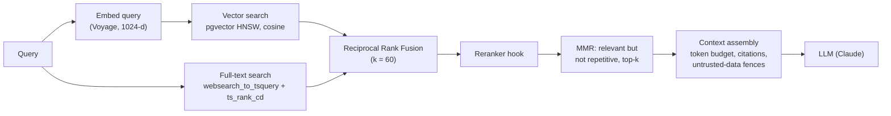
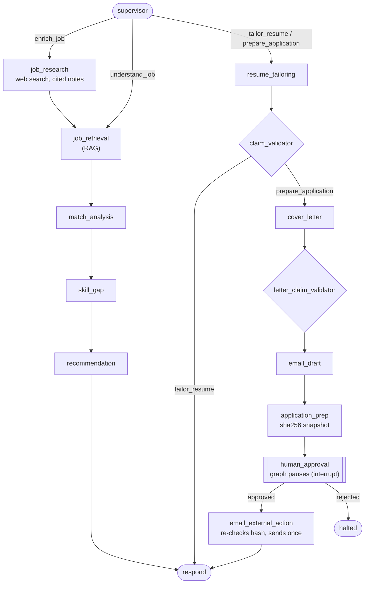

# Mana Career

**Your career. Your next move. Smarter with AI.**

A human-first AI career agent. Mana Career parses your résumé into a structured career
profile, lets you ingest job descriptions, computes an **explainable** résumé↔job match
score, finds your skill gaps, builds a grounded learning roadmap, tailors résumés and
drafts cover letters + application emails, and — through the **Mana AI** agent — prepares
complete applications that **you review and approve before anything is sent**.

> AI recommends → AI prepares → **Human decides.**

The full system design is in
[`docs/superpowers/specs/2026-08-30-mana-career-design.md`](docs/superpowers/specs/2026-08-30-mana-career-design.md);
implementation follows the 14-phase roadmap in §9.

## Status

**All 14 roadmap phases are complete and CI-green on `main`** (backend + `eval` +
frontend + `images` jobs: 753 backend tests against real Postgres + Redis, including
46 in `tests/security/`, with an 80% coverage gate; 276 frontend unit tests; Playwright
end-to-end journeys against the production images; `pip-audit` + `pnpm audit` + Trivy
image scans gate every push).

| Phase | Scope | State |
|---|---|---|
| **0 — Foundations** | monorepo, `core/` (config, logging, `problem+json` errors, async DB + `Repository`, append-only audit log, Redis rate limiting), Alembic bootstrap, app factory + health, ARQ worker, swappable LLM/embeddings seams, dev Docker Compose, Next.js shell + tokens, CI | ✅ |
| **1 — Auth + career profile + shell** | argon2id + HS256 access JWT + rotating refresh with family reuse-detection; `career_profiles` + sub-entities + deterministic strength scorer; design system + auth/profile UI | ✅ |
| **2–3 — Résumé → profile** | PDF parsing, structured extraction, profile generation | ✅ |
| **4–5 — Jobs + matching** | job ingestion + search; deterministic, explainable résumé↔job scorer with per-dimension breakdown + skill gaps | ✅ |
| **6 — RAG** | pgvector retrieval, chunking, `<untrusted_data>`-fenced context assembly | ✅ |
| **7 — Mana AI agent** | LangGraph agent (SSE-streamed), block registry, Activity feed | ✅ |
| **8–9 — Tailoring + letters** | grounded résumé tailoring with a claim validator; cover-letter + application-email drafting | ✅ |
| **10 — Human-approval workflow** | `interrupt()`-gated send, sha256 payload re-verification, `ConsoleEmailSender`, approval UI | ✅ |
| **11 — Application tracker** | append-only `application_events`, status board + timeline UI | ✅ |
| **12 — Career insights + roadmap** | aggregate skill-gap rollup, grounded learning roadmap (streamed), insights + next-best-action | ✅ |
| **13 — Testing + security hardening** | `tests/security/` (tenant isolation, authz, secret redaction, prompt injection, agent limits); `SECURITY.md`; `docs/threat-model.md`; audit + coverage gates | ✅ |
| **14 — Docker + deployment** | multi-stage prod images, `compose.prod.yml` behind nginx/TLS, migrate one-shot, healthcheck-gated startup, seed command, `docs/runbook.md`, Trivy CI scan | ✅ |

Phase specs, plans, and completion reports: [`docs/superpowers/specs/`](docs/superpowers/specs/) · [`docs/superpowers/plans/`](docs/superpowers/plans/).

## What works today

A running API where a user can:

- **Register / log in / refresh / log out / change password** — access tokens are short-lived
  JWTs; the refresh token is an httpOnly `SameSite=Strict` cookie, stored only as a hash, and
  rotates on every use. Presenting an already-rotated token revokes the whole session family.
- **Build a career profile** — one profile per account, auto-created on first read, with
  contact links, job preferences, salary expectations, seniority, goals, and ordered lists of
  work experience, education, projects, and certifications.
- **See a profile-strength score** — a deterministic 0–100 score with a per-section
  completeness map and a plain-language list of what's still missing, recomputed on every edit.

…and, on top of that foundation, the full flow: **résumé upload → structured profile →
explainable job matching → skill gaps → grounded learning roadmap → résumé/cover-letter
tailoring → application prep → human-approval-gated email → application tracking → career
insights** — driven end to end by the **Mana AI** agent, with a human approving every
outbound action.

Every state change and auth event is written to an append-only `audit_logs` table. Every
request carries an `X-Request-ID`; errors are RFC 9457 `application/problem+json` with stable
machine codes. Module boundaries are enforced by `import-linter`.

## How the AI works: RAG and an approval-gated agent

### Retrieval (RAG)

Job descriptions are split into sections and chunked; each chunk is stored with a
1024-dimension embedding (Voyage) **and** a Postgres full-text vector. Retrieval runs
both searches and fuses them, so exact terms ("Kubernetes", "SOC 2") and meaning
("container orchestration") both count.



- **Hybrid search + fusion:** `app/domain/rag/` — `VectorStore` (HNSW `vector_cosine_ops`
  index and `ts_rank_cd` text ranking), `rrf()` and `mmr()` in `fusion.py`, and a
  `Reranker` protocol (a no-op by default, so a cross-encoder can drop in).
- **Tenant-scoped:** every search is limited to the shared catalogue plus the signed-in
  user's own jobs.
- **Prompt-injection fencing:** retrieved text is wrapped in
  `<untrusted_data source=… ref=…>` blocks, and any fence-like text inside a document is
  neutralised so it can't close the fence early. `tests/security/test_prompt_injection.py`
  covers it.
- **Citations and budgets:** the assembled context keeps a citation per block and stays
  inside a token budget.
- **The same retrieval** grounds learning-roadmap planning in a seeded catalogue of
  learning resources.

### The Mana AI agent (LangGraph)

One graph serves four goals: understand a job, research a company, tailor a résumé, or
prepare a whole application. A `supervisor` node routes each run; every node can stop
the run safely (`halted`) on an error or an exhausted budget.



What makes it an *agent you can trust*, not just a chain of prompts:

- **Human in the loop:** `human_approval` pauses the graph with LangGraph `interrupt()`;
  nothing is sent until the person approves. The approved email is hashed (sha256), and
  the send step re-hashes it, so content edited after review is never sent.
- **Grounding checks:** `claim_validator` and `letter_claim_validator` compare every
  generated claim with the person's own résumé and profile (token overlap ≥ 0.60) and
  flag unsupported ones at review instead of silently passing them.
- **Guardrails per run** (`app/domain/agents/budget.py`): at most 24 steps, 12 LLM calls,
  4 web searches and 6 vector searches, 180 seconds and $0.75; plus a retry cap per node.
  `tests/security/test_agent_limits.py` proves the send step is only reachable through
  approval and that runaway runs stop.
- **Durable and observable:** a Postgres checkpointer lets a paused run resume after
  approval (or a restart); each step streams live to the UI over SSE and is written to
  an activity log and the audit trail.
- **At most once delivery:** the send claims the email with one conditional database
  update, so retries or races can't send it twice.

### Evaluation

`backend/eval/` holds golden datasets and a CLI (`python -m eval.run retrieval|generation`)
that CI's `eval` job runs on every push:

- **Retrieval:** recall@10, MRR and nDCG@10 over 18 labelled queries, gated by thresholds
  in `eval/thresholds.py`.
- **Generation:** groundedness (share of claims backed by the source) and keyword
  coverage over 4 cases. In CI it runs against the offline fake provider, so it checks the
  pipeline; the stricter `QUALITY_*` thresholds are for runs with a real model.

### Demo mode

Without API keys the app uses deterministic fake providers, so the whole stack runs
offline and the free deployment (`docs/deploy.md`) costs nothing. The site says so in a
banner. In that mode the vector half of retrieval has no real meaning (the full-text half
still works), letters and tailored résumés are simple templates, and résumé skills come
from matching the text against the skills catalogue. Set `LLM_PROVIDER=anthropic` and
`EMBEDDINGS_PROVIDER=voyage` with keys to see the real model behaviour.

## Stack

- **Frontend:** Next.js (App Router), TypeScript, Tailwind, shadcn/ui, Lucide, TanStack Query
- **Backend:** Python 3.12, FastAPI, ARQ worker, SQLAlchemy 2.0 (async) + Alembic
- **AI:** LangGraph agent, hybrid RAG on pgvector, provider seams: Anthropic Claude (LLM),
  Voyage (embeddings), Tavily (optional web search), plus deterministic fakes for offline
  runs and the free demo
- **Data:** PostgreSQL 16 + pgvector, Redis 7
- **Infra:** Docker / docker-compose · GitHub Actions CI

## Running it

```bash
# full stack (Postgres+pgvector, Redis, API, worker, frontend)
docker compose up --build -d
curl -fsS http://localhost:8000/health        # -> {"status":"ok"}
# API docs at http://localhost:8000/docs, frontend at http://localhost:3000

# backend checks without Docker (needs uv + a reachable Postgres/Redis)
cd backend && uv run ruff check . && uv run lint-imports && uv run mypy app && uv run pytest
```

`just` targets: `just up` / `just down` / `just migrate` / `just ci` / `just smoke`.
Run `just init-env` first: it writes `.env` and `backend/.env` from the templates with
generated secrets (the app refuses placeholder JWT secrets). The LLM and embeddings
providers default to deterministic fakes, so the whole stack runs offline.

**Production:** `compose.prod.yml` builds multi-stage images and runs the stack
behind an nginx reverse proxy with TLS, a one-shot Alembic `migrate` service,
and healthcheck-gated startup. `just prod-up` / `just seed` / `just smoke-prod`;
full procedure (certs, backup, restore, rollback) in
[`docs/runbook.md`](docs/runbook.md).

Before running production Compose commands, set a nonempty generated
`POSTGRES_PASSWORD` and replace the development `JWT_SECRET` with a secret of at
least 32 characters. Web research is optional (`SEARCH_PROVIDER=tavily` with a
`SEARCH_API_KEY`); without it the agent reports that step as skipped. Fake
providers in production need `DEMO_MODE=true`, so a demo is always labelled.

**Free hosting:** Supabase + Render + Vercel + Brevo, step by step in
[`docs/deploy.md`](docs/deploy.md) (config in `render.yaml`).
